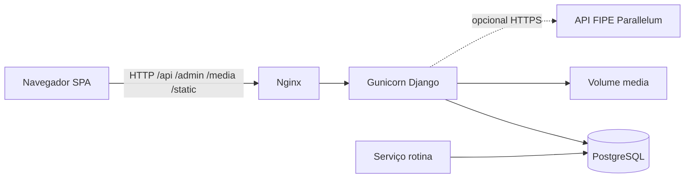

# FROTA-SENAI

Sistema de gestão da frota de veículos do SENAI: reservas, aprovações, check-in e check-out com vistoria fotográfica, CNH, termo de responsabilidade, relatórios e auditoria.

| | |
|---|---|
| Frontend | React 18 + Vite 5 (`SISTEMA-FINAL/`) |
| Backend | Django 5.2 + DRF (`BACKEND/`) |
| Banco | PostgreSQL 16 (Compose) |
| Fuso | `America/Sao_Paulo` |
| Classificação | Uso interno |

Documentação: **[docs/README.md](docs/README.md)**.

## Escopo

Funcionários autenticados (matrícula e senha) solicitam veículos; administradores aprovam; a retirada e a devolução exigem vistoria fotográfica no celular. Há trilha de auditoria.

**Não implementado:** telemetria GPS obrigatória, aplicativo nativo, faturamento, ERP SENAI, envio real de e-mail (código existe e permanece desligado por padrão).

## Arquitetura



O `compose.yaml` publica HTTP (`listen 80`). TLS não está no Compose. Serviços: `db`, `backend`, `rotina`, `web`. A rotina usa o ORM Django contra o PostgreSQL.

## Desenvolvimento local

Não copie `.env` de produção. Use os `.env.example`.

```bash
# Backend
cd BACKEND
python3 -m venv .venv
. .venv/bin/activate
pip install -r requirements.txt
cp .env.example .env   # ajuste DB_* para o PostgreSQL local
python manage.py migrate
python manage.py createsuperuser
python manage.py runserver 0.0.0.0:8000
python manage.py check
```

```bash
# Frontend
cd SISTEMA-FINAL
npm ci
npm run dev          # http://localhost:5173
npm run build
```

Sem `VITE_API_URL`, o cliente usa `http://localhost:8000/api` (ou o mesmo host na porta 8000 na LAN). Ver [docs/operacao/configuracao.md](docs/operacao/configuracao.md).

## Implantação Docker

Siga [README-DOCKER.md](README-DOCKER.md) e [docs/operacao/implantacao.md](docs/operacao/implantacao.md).

```bash
[ -f .env ] || cp .env.example .env
# edite SECRET_KEY, AUDITORIA_CHAVE_INTEGRIDADE, DB_PASSWORD, ALLOWED_HOSTS, CSRF
docker compose up -d --build
docker compose exec backend python manage.py createsuperuser
```

**Nunca** execute `docker compose down -v` em ambiente com dados reais.
