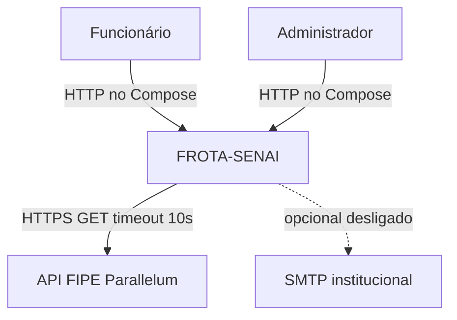
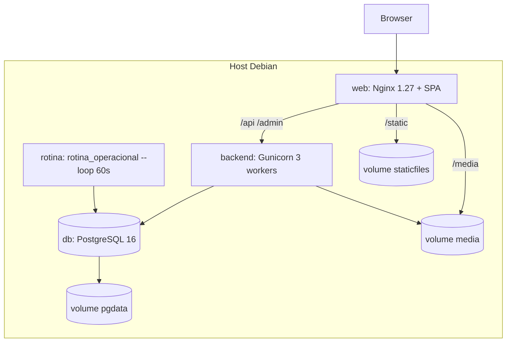
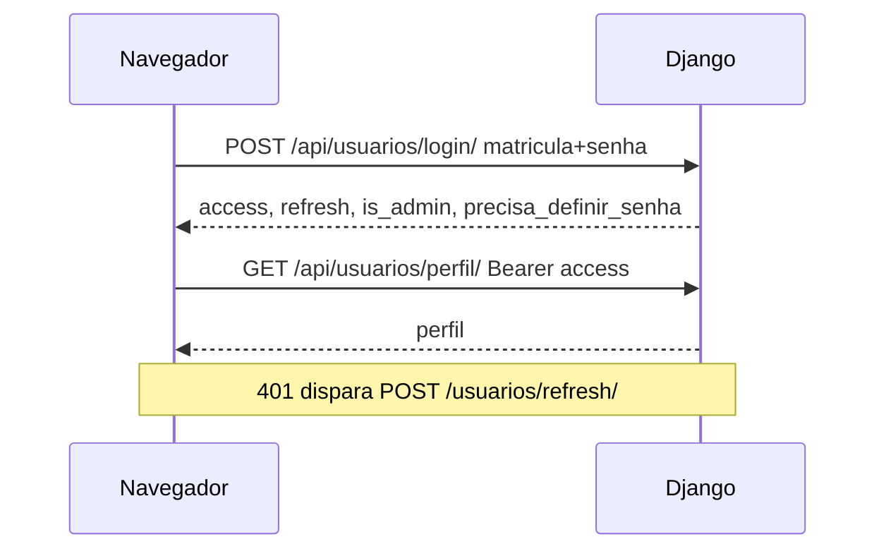

# Arquitetura do sistema — FROTA-SENAI

| Campo | Valor |
|---|---|
| Versão | 1.0 |
| Data | 26 de outubro de 2026 |
| Público | Desenvolvedores e TI |
| Classificação | Uso interno |

## Objetivo

Descrever os componentes, limites de confiança e decisões observáveis no repositório.

## Contexto

O FROTA-SENAI é uma aplicação web monolítica em dois processos de entrega: API Django e SPA React. Usuários são funcionários e administradores da instituição. Integração externa comprovada: API FIPE Parallelum (consulta). E-mail e storage S3/Supabase existem no código como opção, não no Compose mínimo.

TLS **não** está no `compose.yaml` (`listen 80`). HTTPS na borda é recomendação operacional, não um fato deste repositório.

## Componentes (Compose)

| Serviço | Imagem / build | Porta publicada | Persistência |
|---|---|---|---|
| `db` | postgres:16-alpine | nenhuma | `pgdata` |
| `backend` | `BACKEND/Dockerfile` (Python 3.12) | nenhuma (rede interna 8000) | `media`, `staticfiles` |
| `rotina` | mesma imagem; `SKIP_MIGRATE=1` | nenhuma | `media` (leitura/escrita se a rotina tocar arquivos — hoje só DB) |
| `web` | `SISTEMA-FINAL/Dockerfile` | `HTTP_PORT` (80) | monta media/static somente leitura |

Healthchecks: `pg_isready` no db; HTTP `http://127.0.0.1:8000/admin/login/` no backend (Host localhost); wget na raiz do Nginx.

## Frontend

- React 18, React Router 6, Axios, Vite 5.
- `AuthProvider` carrega `GET /usuarios/perfil/` com Bearer.
- `ProtectedRoute` envolve `Layout` (exceto login e definir senha).
- SPA fallback no Nginx: `try_files` → `index.html`.
- `VITE_API_URL` é **build-time**. No Compose vale `/api` (mesmo origin).

## Backend

Apps Django: `usuarios`, `veiculos`, `reservas`, `vistorias`, `termos`, `auditoria`, `relatorios`.

Autenticação API: JWT (`rest_framework_simplejwt`). CSRF aplica-se ao Django Admin (sessão), não ao fluxo JWT da SPA.

Permissão padrão: autenticado + senha já definida (`ExigeSenhaDefinida`). Login, refresh e perfil/definir-senha no primeiro acesso são exceções.

## Autenticação (fluxo)

## Persistência e arquivos

- PostgreSQL: dados transacionais.
- `MEDIA_ROOT`: CNH, termos, fotos de vistoria e de veículo.
- Nginx serve `/media/` como `Cache-Control: private`.
- Alternativa `USE_SUPABASE_STORAGE=True`: S3-compatível; **não** é o caminho do Compose mínimo.
- Estáticos Django: `collectstatic` → volume `staticfiles` → `/static/`.

## Limites de confiança

| Fronteira | Controle |
|---|---|
| Internet → Nginx | Porta HTTP; TLS **não** está no `compose.yaml` (recomendado no proxy ou à frente) |
| Nginx → Gunicorn | Rede Docker interna |
| API → cliente | JWT; autorização por `is_admin` e dono do recurso |
| API → FIPE | Saída HTTPS; sem chave; indisponibilidade responde HTTP 503 |
| Disco media | Volume Docker; permissões do container |
| Auditoria | HMAC com chave de ambiente; append-only |

O frontend **não** é fronteira de autorização: esconder menu `adminOnly` não protege a API.

## Decisões observáveis

Ver [ADRs](../governanca/decisoes/README.md). Resumo:

- JWT em vez de sessão para a SPA.
- Check-in/out atômico em um POST multipart, somente mobile.
- Soft-delete de usuário e veículo.
- Auditoria encadeada.
- Rotina em processo separado (não Celery).
- E-mail opt-in.

## Divergências no código

1. `BACKEND/.env.example` descreve Render/Supabase; o `.env.example` da raiz descreve Docker Debian. No Compose use o da raiz.
2. Endpoints `/reservas/<id>/iniciar/` e `/finalizar/` convivem com `/vistorias/registrar/` (fluxo da UI).
3. A docstring de `validar_checkout_horario_reserva` menciona “24 h”; a função não aplica teto superior.
