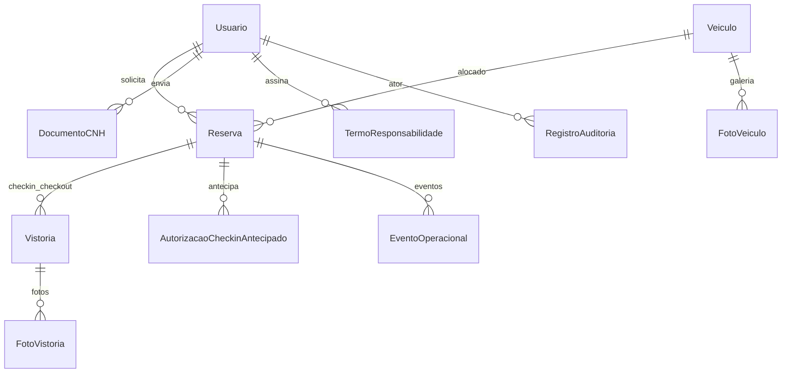
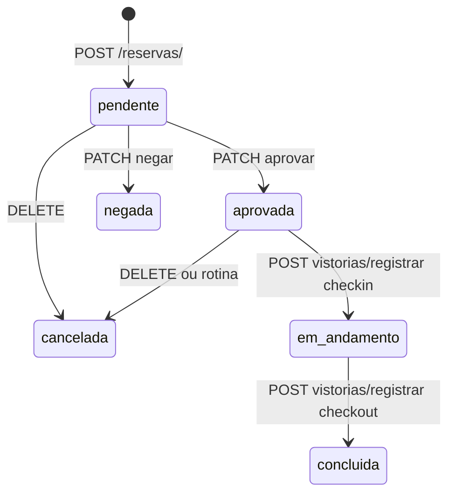

# Modelo de dados — FROTA-SENAI

| Campo | Valor |
|---|---|
| Versão | 1.0 |
| Data | 26 de outubro de 2026 |
| Público | Desenvolvedores e DBA |
| Classificação | Uso interno |
| ORM | Django 5.2, PostgreSQL em produção, SQLite só nos testes |

## Objetivo

Documentar entidades, constraints e transições **presentes nas models e migrations**.

## Diagrama ER (simplificado)

## Entidades

### Usuario (`usuarios.Usuario`)

Autenticação por `matricula` (única). `is_admin` default False. `is_active` default True. `precisa_definir_senha` no primeiro acesso. Soft-delete: `is_active=False`.

### DocumentoCNH

FK usuário. `status`: pendente | aprovado | rejeitado. `data_validade` preenchida na aprovação. Arquivo em `cnh/%Y/%m/`. Sem unique de “uma CNH aprovada”; a regra de reserva usa a vigente mais recente.

### TermoResponsabilidade

Entidade FIBRA/SESI/SENAI/IEL. CPF/CNH normalizados (índice). `VALIDADE_DIAS = 365`. Unicidade CPF/CNH **entre usuários** é validada no serializer, não por unique no banco.

### Veiculo

`placa` unique. Status: disponivel | em_uso | manutencao | inativo. Soft-delete: `inativo`. `km_atual` atualizado no check-out. `data_ultima_manutencao` informativa.

### FotoVeiculo

Galeria; `ordem`. Limite de quantidade na view, não no banco.

### Reserva

Status: pendente | aprovada | negada | em_andamento | concluida | cancelada.  
Modalidade: horario | turno. Turnos: manha (6–12), tarde (12–18), noite (18–22).  
`motivo_cancelamento`: usuario | admin | falta_checkin.  
`unidade_checkin`: snapshot histórico (taguatinga, gama, sobradinho, sig).  
`data_devolucao_real` no check-out.

### AutorizacaoCheckinAntecipado

Unique parcial: uma pendente por reserva.

### EventoOperacional

`chave` unique (idempotência da rotina e de e-mails). Tipos: checkout_atrasado, cancelamento_automatico, e-mails correspondentes.

### Vistoria

Unique `(reserva, tipo)` checkin|checkout. Geo opcional.

### FotoVistoria

Descrições: frente, tras, lateral_esq, lateral_dir, painel.

### RegistroAuditoria

Append-only. `sequencia` unique. `hash` / `hash_anterior` HMAC-SHA256. Snapshots de nomes (sem FK viva no afetado).

## Transições de Reserva

Aprovar **não** altera status do veículo. Check-in: veículo `disponivel` → `em_uso`. Check-out: `em_uso` → `disponivel`.

## Exclusão

| Recurso | Comportamento |
|---|---|
| Usuario | `is_active=False` |
| Veiculo | `status=inativo` |
| Reserva | status `cancelada` (DELETE HTTP) |
| Vistoria | DELETE físico, só admin |
| Auditoria | proibido |

## Migrations

Arquivos em `BACKEND/*/migrations/`. Em Docker o entrypoint executa `migrate --noinput` no `backend` (não no `rotina`, `SKIP_MIGRATE=1`).

Procedimento seguro:

1. Backup do banco e da mídia.
2. Atualizar código.
3. `docker compose up -d --build` (migrate no boot).
4. `showmigrations` e smoke test.
5. Não editar migrations já aplicadas em produção.
6. Não usar `migrate --fake` sem procedimento documentado pela equipe.

`AUDITORIA_CHAVE_INTEGRIDADE` não é migration: é configuração. Alterá-la invalida a verificação da cadeia.

## Índices relevantes

- `Usuario.matricula` unique
- `Veiculo.placa` unique
- `EventoOperacional.chave` unique
- `RegistroAuditoria.sequencia` unique; `criado_em` index
- `AutorizacaoCheckinAntecipado.status` db_index
- `cpf_normalizado` / `cnh_normalizada` index
- Unique vistoria `(reserva, tipo)`
